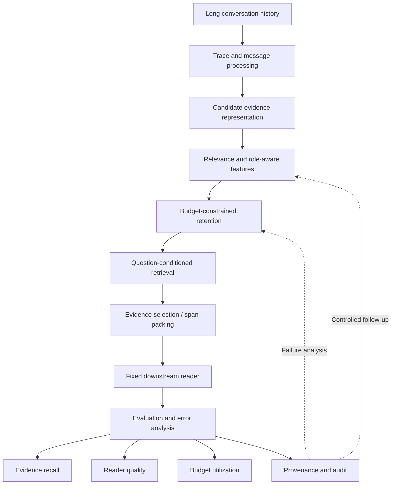

# MemWeave

  <strong>Evidence-centred memory for long-horizon conversational systems</strong> 
  <em>Retaining the right conversational evidence under constrained memory budgets.</em>

  
  
  
  

  <a href="https://tishaaaaaaaaa5-sketch.github.io/memweavee/">🌐 Live project website</a> ·
  <a href="https://tishaaaaaaaaa5-sketch.github.io/memweavee/research.html">Research portal &amp; interactive evaluation</a>

  <a href="#headline-results">Results</a> ·
  <a href="#what-is-memweave">Research</a> ·
  <a href="#method-and-system-design">Method</a> ·
  <a href="#experiments-and-evidence">Experiments</a> ·
  <a href="#reproducibility">Reproducibility</a> ·
  <a href="#research-roadmap">Roadmap</a>

---

## The problem

Conversational assistants accumulate far more history than they can reliably keep in an active context window. A useful memory system therefore needs to do more than summarize or store old messages: it must decide **which evidence to preserve**, retrieve the right evidence when a future question arrives, and do so within an explicit resource budget.

**MemWeave** is a research project investigating evidence-aware, budget-constrained memory retention and retrieval for long-horizon conversations. It studies how conversational structure, message roles, relevance signals, and retention policies affect the evidence available to answer later questions.

The central research question is:

> **When a conversational system cannot retain its entire history, how should it select and organize memory so that future questions remain answerable?**

The project combines benchmark experiments, controlled reconstruction, feature diagnostics, cross-dataset transfer, downstream reader evaluation, and reproducibility audits. It also develops a proposed failure-analysis direction, MFAR, for diagnosing where evidence is lost across a memory pipeline.

## Headline results

The strongest current results are presented below with their evaluation scope. They are **not one pooled leaderboard**: the LongMemEval stages use distinct runs, while LoCoMo and Long-MT-Bench+ provide separate transfer and downstream-reader evidence.

<strong>LongMemEval-S — regenerated role-aware evaluation</strong>

| Measure | Baseline | Role-aware |
|---|---:|---:|
| Budgeted evidence recall | 40.42% | **82.06%** |

- **Absolute gain:** +41.65 percentage points
- **Test set:** 235 questions; 235-question DEV split
- **Model:** logistic regression, C = 0.3
- **Selection budget:** 10% of pool word count (a proxy, not an exact tokenizer budget)
- **Paired bootstrap 95% CI for gain:** +35.87 to +47.42 percentage points

This is the regenerated Stage C run. It is distinct from the earlier Stage B result (70.94% role-aware recall). Both are preserved rather than silently overwriting one another; a controlled reconstruction investigates their difference.

<strong>LoCoMo — frozen cross-dataset transfer</strong>

The LongMemEval-trained selectors were frozen before evaluation on LoCoMo; LoCoMo was not used to fit or tune the models.

| Speaker-role orientation | Baseline macro recall | Role-aware macro recall |
|---|---:|---:|
| speaker_a as user | 9.35% | **61.69%** |
| speaker_b as user | 9.35% | **61.65%** |

- **Evaluation scope:** 10 conversations and 1,536 questions per orientation
- **Conversation-cluster bootstrap intervals** for the role-aware gain were positive in both orientations.

This is meaningful cross-dataset transfer evidence, but not definitive independent replication: the evaluation contains only ten conversation clusters, and speaker-role mapping and evidence-annotation alignment remain audit considerations.

<strong>Downstream reader evaluation — LoCoMo</strong>

The project went beyond evidence recall and evaluated whether selected evidence helps a fixed reader produce better answers.

- FLAN-T5-small and FLAN-T5-base reader evaluations were completed.
- The reported small-reader comparison covered 200 questions across 10 conversations; paired conversation-cluster bootstrap analysis reported a **+0.1401 token-F1** improvement for role-aware selection.
- The reader experiments use evidence-aware span packing and explicit storage budgets.

These are exploratory downstream results on a small number of conversation clusters. LoCoMo had already been used for selector-transfer analysis, so this is not an untouched independent confirmation.

<strong>Long-MT-Bench+ — span-budget evaluation</strong>

- **Evaluation scope:** 288 questions across 11 conversations.
- **Role-aware token F1:** 0.1443
- **Baseline token F1:** 0.0823

This adds a second downstream evaluation setting. The sample remains conversation-clustered and should be interpreted as supporting evidence, not a broad generalization guarantee.

### Results at a glance

| Evaluation | Scope | Main reported outcome |
|---|---|---|
| LongMemEval-S, Stage B | 235 held-out questions | 40.42% → 70.94% evidence recall |
| LongMemEval-S, Stage C | Separate regenerated 235-question test | 40.42% → **82.06%** evidence recall |
| LoCoMo frozen transfer | 10 conversations; 1,536 questions | 9.35% → **61.69%** macro recall in one role orientation |
| LoCoMo reader QA | 200 questions; 10 conversations per reader | FLAN-T5-small paired token-F1 gain: +0.1401 |
| Long-MT-Bench+ | 288 questions; 11 conversations | Token F1: 0.0823 → **0.1443** |

**Metric discipline:** evidence recall measures whether annotated evidence is retrieved. It is not the same as answer accuracy, factuality, or end-to-end assistant quality. Reader metrics are reported separately for that reason.

## What is MemWeave?

MemWeave studies a memory pipeline in which conversational history is transformed into a constrained, traceable evidence store.

Its research focus includes:

- **Conversation structure:** representing user and assistant messages and their relationships.
- **Evidence relevance:** identifying history likely to support future questions.
- **Retention under budgets:** selecting a limited subset of sessions or evidence.
- **Retrieval quality:** measuring whether required evidence can be recovered.
- **Downstream utility:** testing whether selected evidence improves a fixed reader's answers.
- **Failure analysis:** making missing or unobservable pipeline stages explicit rather than guessing what happened.

### Research principles

| Principle | What it means in MemWeave |
|---|---|
| Evidence over summary volume | Preserve information that can support future questions, not simply more text |
| Explicit resource constraints | Evaluate retention under declared memory budgets |
| Traceability | Keep results tied to source data, configurations, and evaluation artifacts |
| Stage separation | Distinguish retention, retrieval, and answer-generation outcomes |
| Controlled comparison | Compare configurations on aligned evaluation data |
| Honest uncertainty | Report confidence intervals, limitations, and unresolved discrepancies |

## Method and system design

The research pipeline separates memory construction from evaluation so that performance changes can be investigated rather than hidden inside one end-to-end score.

### Evaluation layers

1. **Retention:** Which conversations or evidence units survive the memory budget?
2. **Retrieval:** Does the retained memory contain the evidence needed for a held-out question?
3. **Context construction:** Can relevant evidence be packed into a reader's context budget?
4. **Downstream answering:** Does the selected evidence improve a fixed reader's output?
5. **Audit:** Can the reported outcome be traced to a specific dataset revision, configuration, and artifact?

This separation is central to the project's claims. A gain at one layer does not automatically establish a gain at every later layer.

## Experiments and evidence

### 1. LongMemEval role-aware features

The role-aware follow-up augments the baseline feature set with message-role and conversation-structure signals. The held-out Stage B run reported 70.94% budgeted evidence recall; a later regenerated Stage C run reported 82.06%.

The two runs are deliberately retained as separate records. A controlled reconstruction compared their implementation choices on the same 235-question test set:

| Reconstructed condition | Mean evidence recall |
|---|---:|
| Baseline | 40.42% |
| Raw role features, 20k vocabulary | 70.94% |
| Raw role features, unlimited vocabulary | 68.46% |
| Z-score role features, 20k vocabulary | 82.70% |
| Z-score role features, unlimited vocabulary | 82.06% |

The factorial contrasts reported in that reconstruction were:

- **Feature scaling:** +12.68 pp for z-score scaling versus raw features (95% paired-question bootstrap CI: +8.66 to +16.90 pp).
- **Vocabulary cap:** −1.56 pp for the 20k cap versus unlimited vocabulary (95% CI: −2.62 to −0.67 pp).
- **Message filtering:** zero observed effect in this population; all audited messages already met the filter conditions.

These contrasts describe the tested reconstruction, not universal properties of the methods. The reconstruction also does not prove exactly which historical code state generated the original Stage B and Stage C artifacts.

### 2. Feature ablation and interpretation

The Stage C group ablation indicates that the **message-similarity feature group accounts for most of the observed gain** in that run. The user-message and assistant-message groups show much smaller effects after correction; individual leave-one-feature-out effects are not sufficient to claim that every role feature contributes independently.

This matters for interpretation: the measured improvement should not be attributed solely to role-awareness. Stronger question-to-message similarity signals may explain a substantial part of the gain. The current evidence motivates more targeted mechanism-isolation experiments.

### 3. Cross-dataset transfer and reader studies

The frozen LoCoMo transfer evaluation tests whether a selector trained on LongMemEval carries over to another conversational dataset without fitting or tuning on LoCoMo. The reader studies then test downstream utility using fixed FLAN-T5 readers and evidence-aware context packing.

Long-MT-Bench+ adds another span-budget setting. Together, these studies broaden the evaluation beyond a single LongMemEval recall result, while their limited conversation-cluster counts keep the conclusions appropriately provisional.

### 4. Original query-agnostic retention study

The earlier v2.0–v2.3 line of work investigates query-agnostic session retention. Its corrected v2.3 analysis found that the advantage over the strongest simple heuristic was small and sensitivity-dependent. That result is preserved as part of the research history rather than presented as robust superiority.

## Research lineage

MemWeave has evolved through related but distinct experimental stages:

| Stage | Focus | How to interpret it |
|---|---|---|
| v2.0–v2.3 | Query-agnostic retention and benchmark audit | Earlier baseline; corrected result is cautious and sensitivity-dependent |
| Stage B | Role-aware LongMemEval locked-test run | Historical 70.94% role-aware recall |
| Stage C | Regenerated LongMemEval run, feature ablation, LoCoMo transfer | Separate 82.06% result with pinned dataset provenance |
| Stage B/C reconstruction | Controlled comparison of scaling, vocabulary cap, and filtering | Explains implementation contrasts within the reconstructed pipeline |
| Reader studies | LoCoMo FLAN-T5-small/base and Long-MT-Bench+ | Downstream answer-quality evidence under explicit context budgets |
| MFAR design | Memory Failure-Aware Retrieval | Proposed diagnostic framework; not yet validated end-to-end |

For the full technical record, see the [research-branch project guide](https://github.com/tishaaaaaaaaa5-sketch/memweavee/blob/research/memweave-followup-release/MemWeave/README.md), [Stage C report](https://github.com/tishaaaaaaaaa5-sketch/memweavee/blob/research/memweave-followup-release/MemWeave/results/followup_2026/README.md), and [Stage B/C reconstruction report](https://github.com/tishaaaaaaaaa5-sketch/memweavee/blob/research/memweave-followup-release/MemWeave/results/stage_bc_2026-11-26/README.md).

## MFAR: the next research direction

**Memory Failure-Aware Retrieval (MFAR)** is a proposed framework for diagnosing where a memory pipeline loses useful evidence. It distinguishes potential failure points across construction, retention, retrieval, and answering, with the goal of linking observable traces to targeted interventions under resource constraints.

MFAR is currently a **research design and instrumentation effort**, not a validated end-to-end method. The existing retention adapter can represent partial retention traces; it does not manufacture observations for retrieval or answer-generation stages that were not instrumented.

The proposal defines research questions, falsifiable hypotheses, a trace schema, observability requirements, and an evaluation plan. Its next empirical gate is a real instrumented pipeline run with event-lineage, coverage, privacy, and output-equivalence checks.

See the [MFAR algorithm design](https://github.com/tishaaaaaaaaa5-sketch/memweavee/blob/research/memweave-followup-release/MemWeave/docs/research/MFAR_ALGORITHM_DESIGN.md).

## Reproducibility

Reproducibility is treated as part of the research, not as a badge or a claim inferred from a passing notebook cell.

The Stage C follow-up records immutable dataset revisions and SHA-256 checksums for LongMemEval-S and LoCoMo. Its final notebook audit reported **54 PASS, 3 WARNING, 0 FAIL**. Those checks validate the implemented artifact checks; they do not establish an independent rerun or resolve every evaluator-mapping question.

The controlled Stage B/C reconstruction additionally cross-checked derived-artifact checksums, candidate-level recall, and selected-candidate traces. The artifact ZIP integrity check passed, but a ZIP integrity check is not a complete independent release audit.

### Reproduction guidance

- Use the canonical notebook sequence and a clean runtime.
- Preserve the exact notebook revision, dataset revision and checksum, split, feature schema, hyperparameters, budget definition, and package versions.
- Keep Stage B and Stage C outputs separate.
- Recompute results from source data when making a replication claim; artifact-consistency checks alone are not a fresh experiment.
- Do not commit raw conversation histories, answers, or session text. Publish only privacy-safe derived artifacts permitted by dataset terms.

The research branch contains the expanded notebook index, run manifests, audit reports, and supporting result documentation. Start with the [reproducibility audit](https://github.com/tishaaaaaaaaa5-sketch/memweavee/blob/research/memweave-followup-release/MemWeave/docs/reproducibility/REPRODUCIBILITY_AUDIT.md).

## Limitations and responsible interpretation

The project has substantial experimental breadth, but several constraints remain important:

- The Stage B and Stage C LongMemEval headline results differ and must remain separately attributed.
- The research process was iterative rather than preregistered.
- Question-level bootstrap intervals may understate uncertainty when questions share conversations; conversation-cluster inference is used in the transfer and reader analyses where reported.
- LoCoMo and Long-MT-Bench+ evaluations contain relatively few conversation clusters.
- Evidence recall is not equivalent to end-to-end answer correctness.
- The 10% LongMemEval selection budget uses word count as a proxy, not exact tokenizer accounting.
- Feature ablation suggests similarity signals explain much of the gain; the independent contribution of every role feature is not established.
- MFAR is not yet validated end-to-end, and missing pipeline-stage observations must remain explicitly unobserved.

These limitations are not hidden in the headline. They define the next experiments needed to make the conclusions stronger.

## Research roadmap

| Priority | Direction | Objective |
|---|---|---|
| Critical | Reconcile Stage B/C implementation provenance | Establish a single auditable account of the historical result difference |
| Critical | Complete mechanism-isolation experiments | Separate similarity, role, and scaling contributions |
| High | Strengthen cluster-aware evaluation | Improve uncertainty estimates across conversations |
| High | Publish privacy-safe result exports and manifests | Make the completed analyses easier to independently inspect |
| High | Exact tokenizer-based retention budgets | Replace word-count proxies in the next controlled study |
| High | Instrument the full memory lifecycle | Enable real MFAR traces across retention, retrieval, and answering |

## Repository navigation

The default branch provides the project entry point. The expanded research branch contains the detailed follow-up studies and audit materials.

| Resource | What to find there |
|---|---|
| [Research branch](https://github.com/tishaaaaaaaaa5-sketch/memweavee/tree/research/memweave-followup-release) | Expanded notebooks, reports, schemas, scripts, and audit materials |
| [Project guide](https://github.com/tishaaaaaaaaa5-sketch/memweavee/blob/research/memweave-followup-release/MemWeave/README.md) | Detailed project scope and research lineage |
| [Notebook index](https://github.com/tishaaaaaaaaa5-sketch/memweavee/blob/research/memweave-followup-release/MemWeave/notebooks/README.md) | Canonical notebook sequence |
| [Stage C results](https://github.com/tishaaaaaaaaa5-sketch/memweavee/blob/research/memweave-followup-release/MemWeave/results/followup_2026/README.md) | Regenerated LongMemEval, ablation, and LoCoMo transfer |
| [Stage B/C reconstruction](https://github.com/tishaaaaaaaaa5-sketch/memweavee/blob/research/memweave-followup-release/MemWeave/results/stage_bc_2026-11-26/README.md) | Factorial contrasts and artifact cross-checks |
| [Reproducibility audit](https://github.com/tishaaaaaaaaa5-sketch/memweavee/blob/research/memweave-followup-release/MemWeave/docs/reproducibility/REPRODUCIBILITY_AUDIT.md) | Provenance, validation status, and remaining release gates |
| [MFAR design](https://github.com/tishaaaaaaaaa5-sketch/memweavee/blob/research/memweave-followup-release/MemWeave/docs/research/MFAR_ALGORITHM_DESIGN.md) | Proposed next-stage diagnostic framework |

## Citation

MemWeave is an ongoing research project. A formal academic citation should be added once the manuscript's author list, title, venue or publication status, and year are finalized. Until then, cite the repository and identify the work as an ongoing research project.

**Repository:** https://github.com/tishaaaaaaaaa5-sketch/memweavee

---

  <strong>MemWeave — Preserve the evidence that makes future conversations answerable.</strong>

