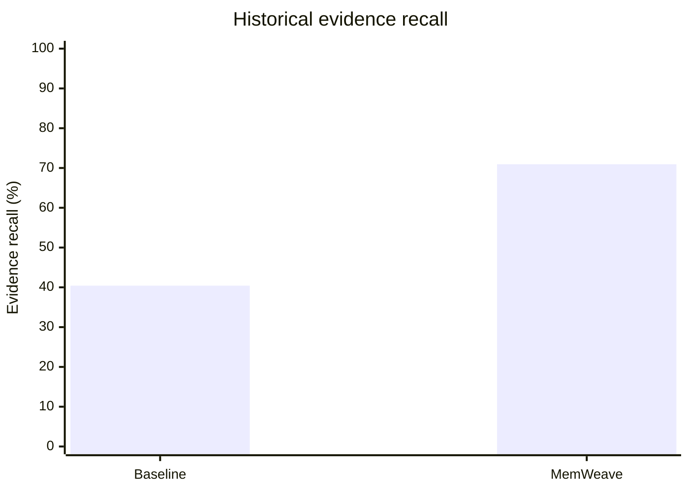
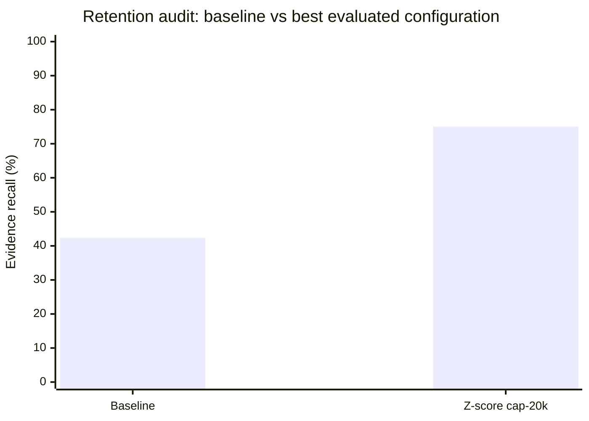
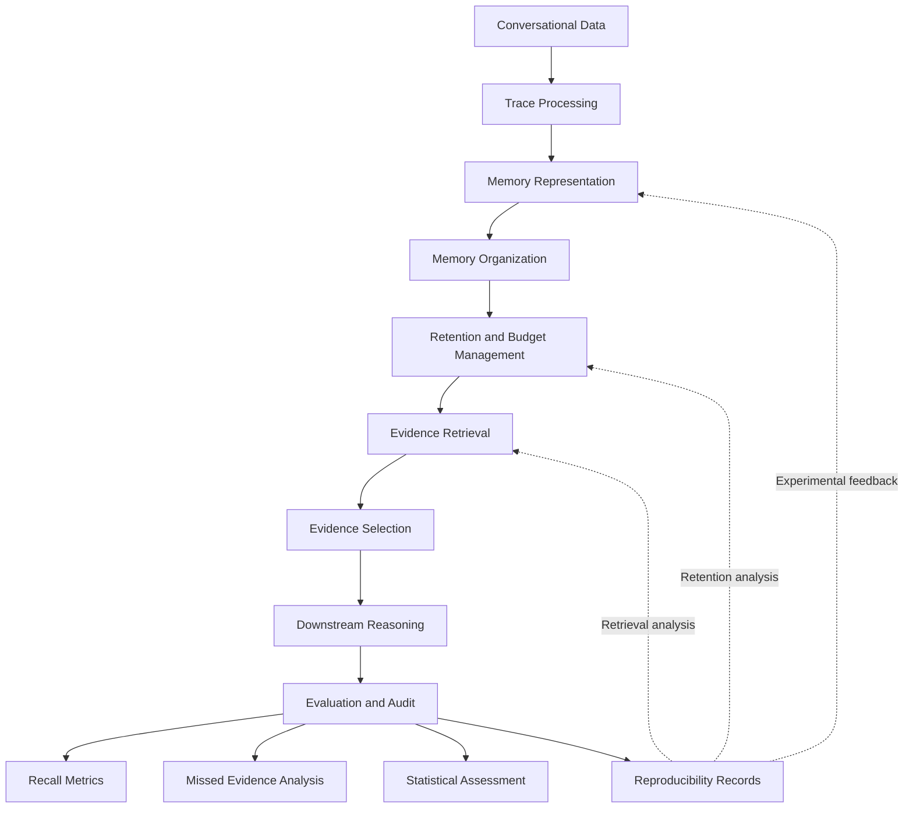
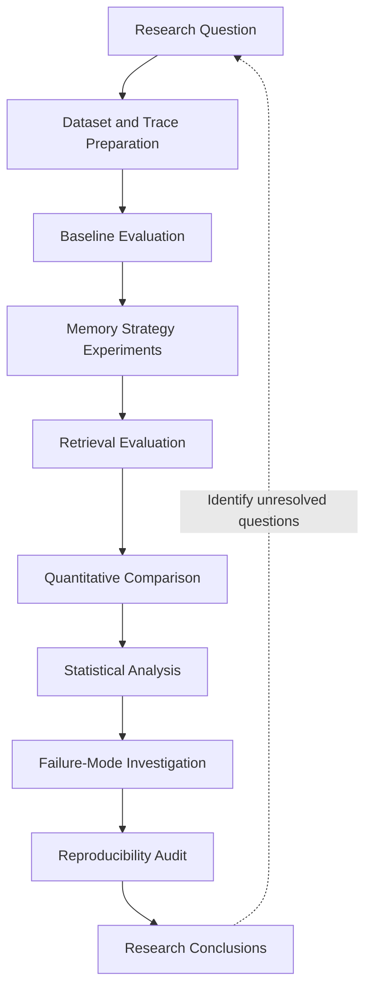
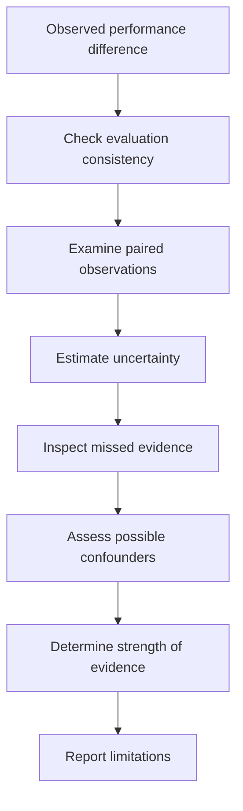
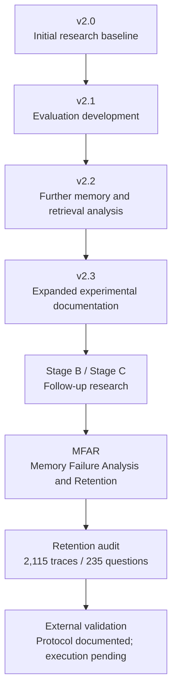
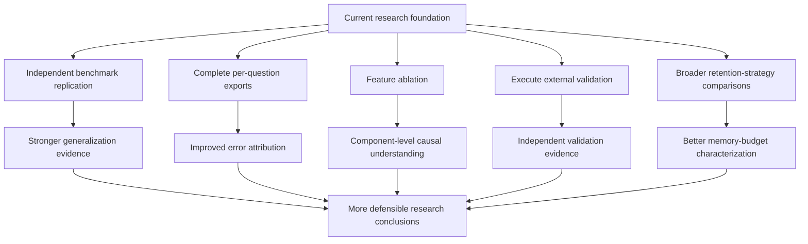

# MemWeave
### A Research Framework for Evidence-Centred Memory, Retrieval, and Long-Horizon Conversational Reasoning

<p align="center">
  <strong>From conversational history to structured, evidence-grounded memory.</strong>
</p>

<p align="center">
  
  
  
  
</p>

---

## 01. Research Overview

MemWeave investigates how conversational systems can retain, organize, retrieve, and use information across extended interactions.

The central research problem is not simply how to store more conversational information. It is how to preserve the information that matters, retrieve the appropriate evidence under constrained memory budgets, and support reliable downstream reasoning.

The project explores an evidence-centred memory pipeline involving:

- Conversational trace processing
- Memory representation and organization
- Relevance-aware evidence retrieval
- Memory-budget and retention strategies
- Quantitative evaluation of evidence recall
- Statistical analysis and reproducibility auditing

The research is structured around a central question:

> Can a conversational memory system improve evidence retrieval while operating under explicit memory constraints, without sacrificing traceability or experimental reliability?

## 02. Key Research Findings

### Evidence retrieval

The original documented evaluation reported an increase in evidence recall from **40.42% to 70.94%** across 235 held-out questions.

<details>
<summary><strong>Historical evaluation — evidence recall</strong></summary>



The reported change corresponds to an absolute improvement of 30.52 percentage points.

This is a historical evaluation result and should be interpreted within its original benchmark and configuration.
</details>

### Additional experimental results

A subsequent regenerated evaluation reported **82.06%** recall. This is a separate result and should not be treated as a direct replacement for the historical 70.94% result without matching the evaluation configuration.

A separate retention audit examined 2,115 traces and 235 questions across eight variants.

| Retention audit measure | Result |
|---|---:|
| Baseline recall | 42.38% |
| Baseline missed evidence | 261 |
| Best evaluated configuration | Z-score, 20k cap |
| Best evaluated recall | 75.06% |
| Missed evidence at best configuration | 113 |
| Memory-budget utilization | 89.85% |



The retention audit also found identical results for its filtered and unfiltered variants. This is an important observation: filtering did not produce a measurable difference under that particular experimental setup.

The audit identified four failure modes as `NOT_OBSERVABLE`. These should remain classified as unobservable rather than being interpreted as successful outcomes.

---

## 03. System Architecture

The conceptual architecture separates the memory lifecycle into distinct stages. This separation makes it possible to evaluate individual components instead of treating memory performance as a single opaque outcome.



### Architectural principles

| Principle | Research objective |
|---|---|
| Evidence preservation | Retain information that supports future questions |
| Retrieval relevance | Retrieve useful evidence rather than merely similar text |
| Budget awareness | Examine performance under memory constraints |
| Traceability | Preserve links between stored memories and source evidence |
| Evaluation separation | Distinguish memory construction from retrieval performance |
| Reproducibility | Record configurations, artifacts, and evaluation procedures |

---

## 04. Experimental Methodology

MemWeave uses a staged experimental approach to separate system development, evaluation, and follow-up analysis.



### Evaluation dimensions

**1. Retrieval quality**

Measures whether the system retrieves the evidence required to answer held-out questions.

**2. Memory efficiency**

Investigates how retention strategies and memory budgets influence the quantity and quality of retained evidence.

**3. Error analysis**

Examines missed evidence and failure modes to identify where the memory pipeline breaks down.

**4. Statistical reliability**

Uses paired comparisons and uncertainty analysis where supported by the experimental data.

**5. Reproducibility**

Documents configurations, artifacts, provenance, and evaluation procedures.

---

## 05. Research Evaluation and Quantitative Analysis

### 5.1 Evidence recall

Evidence recall is a central evaluation measure.

\[
\text{Evidence Recall} =
\frac{\text{Relevant evidence retrieved}}
{\text{Total relevant evidence}}
\]

Higher recall indicates that a greater proportion of the required evidence was retrieved.

However, recall alone does not establish answer correctness, retrieval precision, reasoning quality, or generalization to other benchmarks. These dimensions require separate evaluation.

### 5.2 Retention-budget investigation

The retention audit compares multiple variants under a constrained memory budget.


The strongest evaluated retention configuration in the documented audit was the Z-score strategy with a 20k cap.

Its reported recall was 75.06%, compared with 42.38% for the baseline.

The result is specific to the evaluated dataset, questions, and experimental configuration. It does not establish universal superiority of Z-score retention.

### 5.3 Experimental result separation

The project contains multiple evaluation stages. They should be interpreted independently.

| Evaluation | Dataset / scope | Reported result |
|---|---|---|
| Historical evidence evaluation | 235 held-out questions | 40.42% → 70.94% |
| Regenerated evaluation | Separate regenerated run | 82.06% |
| Retention audit | 2,115 traces; 235 questions; eight variants | 42.38% baseline; 75.06% best evaluated configuration |

These results are intentionally not combined into one performance curve because the experimental configurations are not established as directly comparable.

---

## 06. Statistical Analysis and Scientific Rigor

A research result should not be evaluated solely by its point estimate.

The project therefore includes statistical analysis and reproducibility documentation intended to support more careful interpretation.

The documented evaluation materials include:

- Paired statistical analysis
- Confidence-interval reporting
- Missed-evidence accounting
- Retention-budget analysis
- Configuration and artifact documentation
- Explicit limitations and unresolved questions

### Interpretation framework



### Important scientific limitations

The current evidence should be interpreted with the following limitations in mind:

1. The original evidence-recall evaluation is based on one benchmark.
2. Independent replication has not been established.
3. Per-question exports are incomplete in the documented research history.
4. A complete feature-ablation study has not been established.
5. The external-validation protocol has been documented but has not been executed.
6. Results from different evaluation configurations must not be compared as though they came from a single controlled experiment.

These limitations define the next research steps rather than invalidating the existing experimental observations.

---

## 07. Research Development Timeline



The research lineage is preserved so that later investigations can be distinguished from earlier baselines.

---

## 08. Repository Structure

The repository separates implementation, research notebooks, results, reproducibility documentation, and supporting artifacts.

```text
memweavee/
│
├── MemWeave/
│   ├── notebooks/
│   │   └── Research and evaluation notebooks
│   │
│   ├── results/
│   │   ├── v2_0/
│   │   ├── v2_1/
│   │   ├── v2_2/
│   │   ├── final_locked_test/
│   │   ├── followup_2026/
│   │   └── stage_bc_2026-11-26/
│   │
│   └── README.md
│
├── docs/
│   ├── research/
│   ├── instrumentation/
│   ├── reproducibility/
│   └── figures/
│
├── notebooks/
│   └── archive/
│
├── results/
│   ├── followup_2026/
│   └── artifacts/
│
├── schemas/
├── scripts/
├── tests/
│
├── REPRODUCIBILITY_AUDIT.md
└── README.md
```

### Directory responsibilities

| Directory | Purpose |
|---|---|
| `MemWeave/notebooks/` | Main research and evaluation notebooks |
| `MemWeave/results/` | Versioned experimental outputs |
| `docs/research/` | Research questions, methodology, and findings |
| `docs/instrumentation/` | Instrumentation and measurement documentation |
| `docs/reproducibility/` | Reproduction protocols and supporting records |
| `docs/figures/` | Research figures and visual summaries |
| `results/` | Follow-up results and exported artifacts |
| `schemas/` | Structured data definitions |
| `scripts/` | Supporting execution and analysis scripts |
| `tests/` | Project checks and validation code |

---

## 09. Reproducibility and Research Integrity

Reproducibility is treated as a research requirement rather than a supplementary feature.

The project maintains documentation for:

- Experimental configurations
- Result provenance
- Dataset and evaluation boundaries
- Statistical analysis
- Artifact organization
- Reproduction procedures
- Known limitations

### Audit snapshot

The documented reproducibility audit reported:

| Audit status | Count |
|---|---:|
| PASS | 54 |
| WARNING | 3 |
| FAIL | 0 |

These counts describe the documented audit snapshot; they should not be interpreted as proof that every experiment has been independently reproduced.

### External validation

An external-validation protocol has been documented, including:

- Leakage controls
- Conversation-level splitting
- Independent uncertainty estimates

The protocol has not yet been executed. No external-validation result is claimed.

---

## 10. Research Artifacts and Releases

Research materials and follow-up documentation are maintained separately from the primary stable branch.

The expanded research and instrumentation materials are associated with:

- Branch: `research/memweave-followup-release`
- Pull request: [PR #2](https://github.com/tishaaaaaaaaa5-sketch/memweavee/pull/2)

The research branch contains follow-up documentation and additional analysis. These changes should not be described as merged into `main` unless the pull request has actually been merged.

The documented artifact ZIP export contained:

| Property | Value |
|---|---|
| Files | 52 |
| Size | Approximately 1.51 MB |
| SHA-256 | `32bc3f886f569a8fe788ca62b37032fe51d44178184b432539a7b224b7575634` |
| ZIP integrity check | Passed |

ZIP integrity is not equivalent to a complete independent extraction, manifest, privacy, or terms-of-use audit.

---

## 11. Current Research Gaps and Future Directions

The next stage of work should focus on strengthening the evidence rather than simply increasing the number of experiments.



### Priority research directions

| Priority | Research direction | Scientific objective |
|---|---|---|
| Critical | Independent validation | Test whether observed improvements generalize |
| Critical | Feature ablation | Identify which components contribute to performance |
| High | Complete per-question exports | Improve error analysis and traceability |
| High | Retention-strategy comparisons | Characterize performance under different memory budgets |
| High | Broader benchmark evaluation | Assess robustness beyond the current benchmark |

---

## 12. How to Navigate the Research

A recommended reading sequence:

1. Start with the main research notebook to understand the system and its evaluation.
2. Review the versioned results to understand the experimental progression.
3. Read the retention audit to examine memory-budget behaviour.
4. Review the reproducibility audit for implementation and evidence checks.
5. Examine the follow-up research materials for unresolved questions and next-stage experiments.

---

## 13. Research Scope and Responsible Interpretation

MemWeave is an experimental research project. Its reported metrics describe particular datasets, configurations, and evaluation procedures.

The project does not claim that:

- Evidence recall is equivalent to answer accuracy.
- A single benchmark establishes generalization.
- A higher point estimate alone establishes statistical significance.
- Different experimental configurations can be directly compared without qualification.
- A documented validation protocol constitutes completed validation.

The objective is to develop a transparent and experimentally defensible approach to conversational memory and evidence retrieval.

---

## 14. Project Status

**Research status:** Active experimental development.

**Current focus:** Evidence retrieval, retention analysis, statistical interpretation, and reproducibility.

**Research branch:** `research/memweave-followup-release`

**Open research pull request:** [PR #2](https://github.com/tishaaaaaaaaa5-sketch/memweavee/pull/2)

---

## Citation

If you use, extend, or evaluate this research, please cite the repository and its associated research materials.

**Repository:** [tishaaaaaaaaa5-sketch/memweavee](https://github.com/tishaaaaaaaaa5-sketch/memweavee)

---

<p align="center">
  <strong>MemWeave — Building memory systems that preserve evidence, not just information.</strong>
</p>

